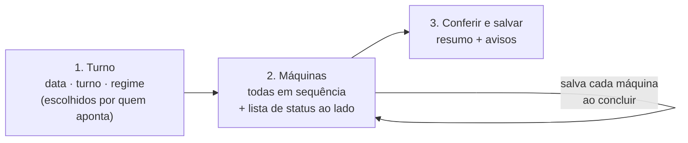

# Proposta: um Apontamento mais simples para o distribuidor

> 08/10/2026 · Sessão da interface · **Proposta, nada disto está implementado.**
> Pedido do usuário no item 8 das decisões da auditoria
> ([relatório](auditoria-2026-10-07.md)).
>
> **Protótipo clicável:** [`prototipo-apontamento.html`](prototipo-apontamento.html)
> (abra no navegador; dados fictícios, nada é gravado).
>
> Revisão de 08/10: data, turno e regime ficam com quem aponta (sem
> preencher pelo relógio).

## Como é hoje

Uma página longa com as 22 máquinas abertas ao mesmo tempo, agrupadas por
linha. Cada máquina tem a coluna da esquerda (nome, etiquetas, o que já foi
gravado, barra de meta, OP liberada, nº de operadores) e a da direita (OPs,
quantidade, retrabalho, observação). No topo: data, turno, regime e filtro. Um
único "Salvar apontamento" grava tudo.

O que pesa para quem aponta no fim do turno:

1. **Muita coisa na tela de uma vez.** Quem aponta é o distribuidor, que
   responde pelas 22 máquinas: todas abertas ao mesmo tempo, num cartão alto
   cada, tornam difícil saber o que já foi feito e o que falta.
2. **Digitar o que o sistema já sabe.** A OP liberada aparece na esquerda, mas
   precisa ser escolhida de novo no campo da direita.
3. **Um salvar só para tudo.** Se a conexão cai ou a pessoa sai da tela, perde o
   que digitou nas outras máquinas.
4. **Máquina parada não tem como ser dita.** "13 de 22" não diferencia quem
   esqueceu de quem não produziu.
5. **Erro de digitação passa.** Um zero a mais (40.000 em vez de 4.000) é
   gravado sem aviso.

## A proposta: três passos

### 1. Turno — quem aponta escolhe

- Data, turno e regime **começam vazios** e são escolhidos por quem aponta. A
  tela não adivinha: sem os três, não passa para as máquinas.
- Trocar o turno depois pede confirmação, porque a lista recomeça para o
  turno novo.
- Só os nomes: "Turno 1/2/3" e "Normal/Hora extra", sem horários nem
  explicações embaixo (pedido de 08/10/2026).

### 2. Máquinas — todas em sequência, cada uma com "Concluir"

> Revisto em 08/10/2026. A primeira versão abria uma máquina por vez, pensando
> num operador com 2 ou 3 máquinas. Quem aponta é o **distribuidor**, que
> responde pelas 22: para ele, abrir e fechar uma tela por máquina seria mais
> lento que a página de hoje. A versão nova mantém todas as máquinas na página.

- **Lista de status fixa ao lado** (no celular, uma barra fixa no topo com
  "7 de 22 concluídas" e "Próxima pendente"). Cada máquina aparece com uma
  bolinha: vazia = pendente, verde = apontada, cinza = não produziu. A próxima
  pendente fica destacada. Clicar leva até a máquina.
- **Todas as máquinas em sequência, por linha**, como hoje: Nº da OP (começa
  vazio), quantidade, retrabalho com o campo do motivo, nº de pessoas só onde
  muda a meta, observação recolhida.
- **"Concluir" em cada máquina:** grava aquela máquina na hora, recolhe o
  cartão numa linha de resumo ("3.900 peças · OP 4510204", com "Editar") e
  leva o cursor ao Nº da OP da próxima pendente. **Enter na quantidade também
  conclui**, para quem digita em sequência. Nada se perde se a pessoa sair no
  meio.
- **"Não produziu"** com motivos rápidos (parada, manutenção, sem OP, sem
  operador, setup). A máquina sai de "pendente" e o contador passa a contar só
  quem realmente falta (depende do banco: etapa D).
- O aviso de quantidade acima de 2× a meta continua no cartão, com "Está
  certo" (etapa A, já no app).

### 3. Conferir e salvar

Um resumo antes de terminar o turno: quantas máquinas apontadas, quantas
paradas, quantas faltam, total de peças, e **avisos de conferência**:

- quantidade acima de 2× a meta do turno ("Confere 40.000? A meta é 4.000");
- mesma OP em duas máquinas;
- máquina com produção e nº de operadores vazio, quando ele muda a meta.

Os avisos não bloqueiam: "Está certo" segue em frente.

## O que muda para quem não é operador

Nada na navegação: continua sendo a aba Apontamento. O gestor que corrige um
dia antigo usa os mesmos passos (escolhe a data no passo 1). O Histórico segue
sendo o lugar de corrigir apontamentos já gravados.

## Em que ordem fazer

| Etapa | O que entra | Depende do banco? |
|---|---|---|
| A | Aviso de quantidade acima de 2× a meta, com pergunta ao salvar. **Feito** (`d0c548b`, `44c9608`). A OP liberada pré-escolhida ficou de fora por decisão do usuário: o nº da OP começa vazio | Não |
| B | Lista de status fixa ao lado + "Concluir" em cada máquina (grava por máquina, recolhe o cartão e leva à próxima pendente); todas as máquinas continuam na página. **Feito** em 08/10/2026: abaixo de 1440px a lista vira uma barra fixa com o progresso e a próxima pendente; máquina já apontada aparece recolhida, com "Lançar mais" e "Corrigir no Histórico"; "Salvar apontamento" (Ctrl+S) continua gravando todas de uma vez | Não: o `saveEntries` aceita uma lista com uma máquina só. Como ele acrescenta (D30), reabrir uma máquina concluída mostra o que já foi gravado, como hoje |
| ~~C~~ | ~~"Suas máquinas"~~. **Retirada em 08/10/2026:** quem aponta é o distribuidor, responsável por todas as máquinas, então não há "máquinas de cada pessoa" | — |
| D | "Não produziu" com motivo. **Feito** em 09/10 e **ligado ao campo do banco** em 11/10/2026 (D67): botão "Não produziu" no cartão da máquina; o motivo é texto livre, com 6 sugestões (Manutenção, Setup / troca, Sem OP, Sem operador, Falta de material, Máquina parada); a caixa "Parada planejada" vem marcada para Manutenção e Setup / troca e pode ser mudada. Parada planejada sai da meta do turno, as outras continuam contando. Aparece na lista de situação, no resumo ("Não produziram") e no Histórico, onde também se corrige (caixa "A máquina não produziu neste turno" na edição do apontamento). [Protótipo](prototipo-nao-produziu.html) | Sim, e já feito: `motivoParada` e `paradaPlanejada` no contrato (nota `2026-10-09-resposta-do-banco-maquina-que-nao-produziu.md`) |

A **A** já está no app. Recomendo testar a **B** com o distribuidor, no
aparelho que ele usa no fim do turno, antes de trocar a tela de vez.

## Ambiente de apontamento (08/10/2026)

Ao clicar em Apontamento, a navegação lateral **recolhe** e a tela vira um
ambiente próprio, com os três passos numa barra fixa no topo (nome, passos, o
turno escolhido com "Trocar", ações do turno e "Sair"). A navegação abre como
gaveta pelo botão do topo, à esquerda, sem sair do apontamento. "Sair" e
qualquer link do Dash pedem confirmação se houver algo digitado e não
concluído. Turno e regime são escolhidos em cartões com borda; botões
secundários e a lista de situação também têm caixa visível; clicar numa
máquina da lista rola até ela com animação. **Feito no app.**

**Campos mais altos (11/10/2026).** Dentro do ambiente de apontamento (barra do topo e corpo da página) botões, campos, caixas de seleção e filtros têm 44px de altura, a área de toque para tablet e luva; no resto do Dash seguem com 32px. É um ajuste do tamanho dos controles só nessa tela (`TOUCH` em `EntryPage.tsx`); janelas e menus não mudam.

**Rascunho no navegador (11/10/2026).** O que está digitado e ainda não concluído (OP, quantidade, retrabalho e motivo, observação, nº de operadores, "Não produziu") é guardado no `localStorage` a cada alteração (`features/entry/draft.ts`), para sobreviver a queda de energia, navegador fechado ou computador travado. Ao voltar ao Apontamento, o passo 1 oferece **Restaurar** ou **Descartar**. Regras: fica só neste computador e é de quem entrou; cada máquina concluída sai do rascunho; terminar o turno apaga tudo; o logout apaga os rascunhos de quem saiu; vence em 48 horas. Para continuar em outro computador seria preciso rascunho no servidor (demanda para o banco, não feita).

**Três ajustes do Apontamento (11/10/2026).** (1) O cartão da máquina tem duas colunas a partir de 768px: contexto à esquerda (nome, linha, situação, meta, OP liberada, andamento) e o que se digita à direita (OPs, nº de operadores, "Não produziu"); abaixo disso volta a uma coluna. (2) As linhas da lista de situação ao lado têm 44px. (3) A confirmação "Sair do apontamento?" vale para qualquer mudança de rota com algo digitado e não concluído, não só clique em link: botão Voltar do navegador, atalho de notificação ou código. O roteador consulta o guarda registrado pela tela (`lib/routeGuard.ts`) e, se ele segurar, o endereço volta ao Apontamento. [Protótipo](prototipo-tres-ajustes.html)

**Nº da OP opcional, por enquanto (12/10/2026, ajuste temporário).** A pedido do gestor, o Apontamento não exige mais o número da OP. Sem número, a linha vai como o número reservado `0` (o banco só aceita de 1 a 15 dígitos, D57) e aparece como "Não informado" nas telas. Recado ao banco em `docs/database/notas/2026-10-12-op-nao-informada.md`, com o efeito (uma OP `0` a conferir) e o pedido de um valor próprio. A constante é `NO_OP` em `data/machines.ts`.

**Perfil e Preferências (13/10/2026).** O menu do avatar abre `#/perfil` e `#/preferencias`. As preferências são pessoais, de cada conta (tema, página inicial, barra lateral aberta, controles de 44px no Apontamento, rascunho), salvam sozinhas e ficam no navegador por usuário, atrás de um `PrefsStore` que o banco pode assumir depois. O Perfil mostra nome, perfil e tipo de conta e envia o link de troca de senha. Foto de perfil, preferências na conta e troca de senha logado dependem do banco: `docs/database/notas/2026-10-13-preferencias-e-foto-de-perfil.md`. [Protótipo](prototipo-perfil-preferencias.html)

**Filtro de máquinas do Histórico (14/10/2026).** O filtro "Máquinas" passou de escolha única a uma lista com caixinhas: desmarcar tira a máquina da conta, ou dá para deixar só algumas (busca por nome, "Só as encontradas", "Tirar as encontradas", grupos Montagem, Embalagem e Granel). Calendário, produção do dia, atingimento (só máquinas com meta) e tabela contam só as marcadas. As que ficaram de fora aparecem como etiquetas com ✕. O endereço guarda o filtro (`#/historico/sem:<ids>`, `#/historico/so:<ids>`, ou um id só, como o "Histórico da máquina" do Dashboard); `features/history/machineFilter.ts`. Vale só no Histórico. [Protótipo](prototipo-filtro-maquinas.html)

**Aba Montagem, Ranking e filtro de máquinas (14/10/2026).** (1) A página da linha Montagem passa a listar, abaixo da tabela das máquinas com meta, os **postos por demanda** (kits parafusos, bancadas, prensas) com a produção: eles continuam fora do atingimento e dos totais. (2) O **Ranking de máquinas** ganha os filtros da tela Retrabalho: período, máquinas (a mesma lista com caixinhas do Histórico, agora em `features/machines/`), turno e motivo (o motivo só vale no critério Retrabalho). Fora do período padrão não há posição da semana passada para comparar. (3) O painel do filtro de máquinas perdeu o texto "Desmarque para tirar".
